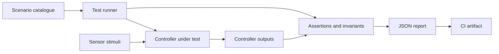

# Architecture

## Scope
This project validates a deterministic supervisory-control reference model against simulated inputs. It is not a turbine OEM model, certified safety function, pitch/torque controller, or validated digital twin.

## Components
1. Scenario catalogue creates reproducible sensor inputs and operator actions.
2. Controller under test maps inputs to state, power, pitch, brake, and fault outputs.
3. Optional plant model provides simple first-order rotor response for demonstrations.
4. Runner executes sequences and checks expected outcomes plus invariants.
5. Reporter produces versioned JSON regression evidence.
6. CLI and CI provide repeatable local and pull-request execution.

## State model
- STOPPED: generation inhibited; brake applied.
- STARTING: valid start request accepted.
- RUNNING: below-rated generation.
- DERATED: rated-wind operation.
- SHUTTING_DOWN: controlled stop or below-cut-in.
- FAULT: latched trip; zero power, shutdown pitch, brake applied.

Production implementations should separate normal supervisory control from independent protection functions and verify safe-state behaviour on the target hardware.
